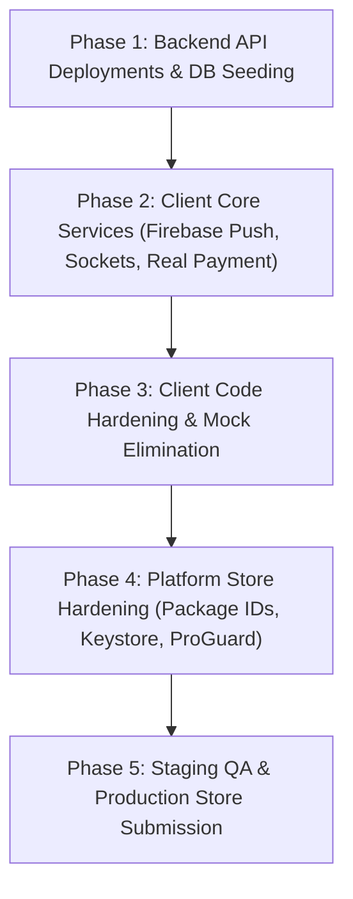

# Eatoggy Customer App — Comprehensive Production Audit & Master Action Plan

> **Application**: Eatoggy Customer Mobile App (`eatoggy-userapp`)  
> **Release Target**: Production Launch (Google Play Store & Apple App Store)  
> **Current Code Health**: `flutter analyze` passing with **0 errors** (27 info/lint warnings)  
> **Critical Blockers**: Food Payment Verification 404 + FCM Push Notifications missing + Apple Account Deletion 404 + Android Package ID `com.example.*` + iOS Maps Initialization

---

## Executive Summary

The **Eatoggy Customer Mobile App** is a feature-rich food delivery and meal subscription platform built with **Flutter 3.47 (Dart 3.13)**, utilizing **BLoC/Cubit** for reactive state management and **GoRouter** for declarative navigation. The application provides an elegant customer experience covering instant food ordering, curated gourmet dining, multi-day royal tiffin subscriptions, saved delivery addresses, coupon validation, live order tracking, and support ticketing.

While the mobile UI, models, and local fallback state are robust and clean, **several mission-critical backend endpoints and native client configurations must be addressed before the app can be submitted to production stores**.



---

## 1. Comprehensive Application Architecture Audit

### 1.1 Tech Stack & Code Quality
* **Framework**: Flutter 3.47.4 (Stable channel), Dart 3.13.3
* **State Management**: `flutter_bloc` / Cubit architecture across 12 distinct feature domains
* **Navigation**: `go_router` 12.1.3 with deep linking and custom slide page transitions
* **Network & HTTP**: `dio` 5.4.0 with token injection interceptor and automated 401 refresh token flow
* **Payment Gateway**: `razorpay_flutter` 1.4.7 with dynamic server-driven key resolution
* **Mapping & Location**: `google_maps_flutter` 2.18.2, `geolocator` 14.0.3, `geocoding` 5.0.0
* **Static Analysis**: `flutter analyze` produces **0 compilation errors**, 27 minor warnings (`use_build_context_synchronously`, `deprecated_member_use`, `prefer_const_constructors`).

### 1.2 Core Identified Architectural Risks
1. **Mock Repository in Main Bootstrapper**: In [lib/main.dart](file:///Users/dhruva/Documents/KMP%20Android/Eatoggy/Eatoggy-usserapp/eatoggy-userapp/lib/main.dart#L55), the app initializes `final repository = MockAppRepository();` which supplies mock fallback food items and dummy order IDs if remote fetching fails.
2. **Missing Push Notification Engine**: `firebase_core` and `firebase_messaging` are absent from `pubspec.yaml`. The app has a REST client in `notification_service.dart` but no native FCM SDK listening for incoming push payloads.
3. **Commented-out WebSocket Service**: [socket_service.dart](file:///Users/dhruva/Documents/KMP%20Android/Eatoggy/Eatoggy-usserapp/eatoggy-userapp/lib/core/services/socket_service.dart) is fully commented out, leaving real-time rider tracking reliant on polling.
4. **Android Package Identifier**: [android/app/build.gradle.kts](file:///Users/dhruva/Documents/KMP%20Android/Eatoggy/Eatoggy-usserapp/eatoggy-userapp/android/app/build.gradle.kts#L24) specifies `applicationId = "com.example.eatoggy"`, which is strictly rejected by Google Play Console.
5. **iOS Google Maps Crash Risk**: [ios/Runner/AppDelegate.swift](file:///Users/dhruva/Documents/KMP%20Android/Eatoggy/Eatoggy-usserapp/eatoggy-userapp/ios/Runner/AppDelegate.swift) lacks `GMSServices.provideAPIKey(...)`. On physical iOS devices, opening map screens will fail or crash without native SDK initialization.

---

## 2. Master Backend API Audit & Requirements Specification

The backend runs on Node.js/Express with MongoDB. Below is the full audit of all endpoints required by the customer app, cross-referenced with live API testing.

### 2.1 Status Overview
* **Total Evaluated Endpoints**: 42
* **Operational (200 / 201 OK)**: 16
* **Critical Missing Routes (404 Route Not Found)**: 14
* **Validation / Auth Middleware Issues**: 6
* **Optional / Deprecated Routes**: 6

---

### 2.2 Critical Priority 0 (P0) Blockers — Must Deploy Immediately

#### 🔴 P0.1: Food Order Razorpay Payment Verification
* **Endpoint**: `POST /api/checkout/verify-payment`
* **Auth**: Bearer JWT (`authCustomer`)
* **Current Status**: `HTTP 404 Route not found`
* **Why It Is P0**: Customers can pay money via Razorpay checkout, but the backend fails to verify the HMAC signature, leaving the order stuck in `PENDING_PAYMENT` and never forwarded to the restaurant kitchen.
* **Request Body**:
  ```json
  {
    "checkoutSessionId": "chk_session_65f1234abcd",
    "razorpayOrderId": "order_EK53Ju3rO1cu12",
    "razorpayPaymentId": "pay_EK53nIPlb2p123",
    "razorpaySignature": "9f83cf134c8a29a6fb514be8c8942b08a1c97a523b092248557a53f2253818e6"
  }
  ```
* **Expected Response (`200 OK`)**:
  ```json
  {
    "success": true,
    "message": "Payment verified and order confirmed successfully",
    "data": {
      "order": {
        "id": "6aba43dcd4360b9e1933b2b9",
        "orderNumber": "#EAT-2026-98102",
        "status": "CONFIRMED",
        "paymentStatus": "PAID",
        "grandTotal": 485.0,
        "placedAt": "2026-10-16T12:00:00Z",
        "estimatedDelivery": "30-40 mins"
      }
    }
  }
  ```

#### 🔴 P0.2: Register FCM Device Token for Push Notifications
* **Endpoint**: `POST /api/notifications/subscribe`
* **Auth**: Bearer JWT (`authCustomer`)
* **Current Status**: `HTTP 404 Route not found`
* **Why It Is P0**: The backend cannot send order status push notifications (Order Confirmed $\rightarrow$ Kitchen Preparing $\rightarrow$ Valet Picked Up $\rightarrow$ Arriving $\rightarrow$ Delivered).
* **Request Body**:
  ```json
  {
    "fcmToken": "f7Z_abc123d4e5f6g7h8_sample_device_fcm_token...",
    "deviceType": "android",
    "appVersion": "1.0.0"
  }
  ```
* **Expected Response (`200 OK`)**:
  ```json
  {
    "success": true,
    "message": "Notification token registered successfully"
  }
  ```

#### 🔴 P0.3: Customer Account Deletion (Apple App Store Guideline 5.1.1)
* **Endpoint**: `DELETE /api/customer-auth/account`
* **Auth**: Bearer JWT (`authCustomer`)
* **Current Status**: `HTTP 404 Route not found`
* **Why It Is P0**: Apple strictly enforces that all apps offering account creation must allow permanent in-app account deletion. The app will be rejected during App Store review if this endpoint returns 404.
* **Expected Response (`200 OK`)**:
  ```json
  {
    "success": true,
    "message": "Customer account deleted successfully"
  }
  ```

#### 🔴 P0.4: Customer Profile Update
* **Endpoint**: `PATCH /api/customer-auth/me`
* **Auth**: Bearer JWT (`authCustomer`)
* **Current Status**: `HTTP 404 Route not found`
* **Why It Is P0**: Customer cannot update name, email, or dietary preferences from the Profile & Settings screens.
* **Request Body**:
  ```json
  {
    "name": "Dhruva Sharma",
    "email": "dhruva@example.com",
    "dietaryPreference": "VEG"
  }
  ```
* **Expected Response (`200 OK`)**:
  ```json
  {
    "success": true,
    "message": "Profile updated successfully",
    "data": {
      "customer": {
        "id": "6aba2d5296d118c6b8704eed",
        "name": "Dhruva Sharma",
        "mobile": "9876543210",
        "email": "dhruva@example.com"
      }
    }
  }
  ```

#### 🔴 P0.5: Live Order GPS Tracking Polling
* **Endpoint**: `GET /api/customers/orders/tracking/:orderId`
* **Auth**: Bearer JWT (`authCustomer`)
* **Current Status**: `HTTP 404 Route not found`
* **Why It Is P0**: In [tracking_repository.dart](file:///Users/dhruva/Documents/KMP%20Android/Eatoggy/Eatoggy-usserapp/eatoggy-userapp/lib/features/tracking/data/repositories/tracking_repository.dart#L16), live tracking polling fails with 404 and defaults to mock coordinates.
* **Expected Response (`200 OK`)**:
  ```json
  {
    "success": true,
    "data": {
      "orderId": "6aba43dcd4360b9e1933b2b9",
      "status": "OUT_FOR_DELIVERY",
      "eta": "15-20 mins",
      "valet": {
        "name": "Vikram Singh",
        "phone": "+919876543210",
        "rating": 4.8,
        "currentLocation": { "lat": 28.4595, "lng": 77.0266 }
      },
      "destination": { "lat": 28.4682, "lng": 77.0345 }
    }
  }
  ```

---

### 2.3 Priority 1 (P1) Endpoints — Core Feature Parity

| # | Endpoint | Method | Auth | Current Status | Purpose & Impact |
|:---:|:---|:---:|:---:|:---:|:---|
| **1** | `/api/offers` | `GET` | Bearer JWT | 🔴 404 | Lists available discount promo codes on cart and offers screens |
| **2** | `/api/offers/apply-coupon` | `POST` | Bearer JWT | 🔴 404 | Validates coupon codes and calculates discount amount |
| **3** | `/api/customers/orders/:id/cancel` | `POST` | Bearer JWT | 🔴 404 | Allows customer cancellation before kitchen accepts order |
| **4** | `/api/customers/orders/:id/review` | `POST` | Bearer JWT | ⚪ Missing | Accepts food star rating and review feedback |
| **5** | `/api/serviceability/check?lat=&lng=` | `GET` | Public | 🔴 404 | Geofence verification for delivery coverage |
| **6** | `/api/public/config` | `GET` | Public | 🔴 404 | Dynamic runtime keys (Razorpay key, Google Maps key, support phone) |
| **7** | `/api/customers/discovery/restaurants` | `GET` | Bearer JWT | 🟢 200 (Auth Required) | Guest browsing strictly locked; only authenticated customers can browse |
| **8** | `/api/customers/discovery/gourmet` | `GET` | Public | 🟡 Unpopulated | Needs `.populate('restaurantId')` to show restaurant details |

---

### 2.4 Priority 2 (P2) Endpoints — Polish & Auxiliary Features

| # | Endpoint | Method | Auth | Current Status | Purpose |
|:---:|:---|:---:|:---:|:---:|:---|
| **1** | `/api/customers/preferences` | `PATCH` | Bearer JWT | 🔴 404 | Notification opt-in preferences (Push, SMS, Email) |
| **2** | `/api/customer/wallet` | `GET` | Bearer JWT | 🔴 404 | Loyalty wallet balance & cashback credits |
| **3** | `/api/categories` | `GET` | Public | 🔴 404 | Dynamic food category filter pills on home screen |
| **4** | `/api/customer-auth/logout` | `POST` | Bearer JWT | 🔴 404 | Invalidate refresh token on server |
| **5** | `/api/customer/starter-pack` | `GET` | Public | 🔴 404 | Promotional first-time user discount banner |

---

### 2.5 Currently Operational Endpoints (Verified Working)
* 🟢 `POST /api/customer-auth/send-otp` (Phone OTP dispatch)
* 🟢 `POST /api/customer-auth/verify-otp` (OTP verification & JWT token return)
* 🟢 `GET /api/customer-auth/me` (Profile retrieval)
* 🟢 `GET /api/customers/addresses` (Saved address list)
* 🟢 `POST /api/customers/addresses` (Add new address)
* 🟢 `GET /api/customers/discovery/banners` (Home promotional carousel)
* 🟢 `GET /api/customers/discovery/collections` (Home culinary collections)
* 🟢 `GET /api/customers/discovery/search?q=` (Menu and restaurant search)
* 🟢 `GET /api/cart` (Customer cloud cart)
* 🟢 `GET /api/customers/orders` (Order history)
* 🟢 `GET /api/customers/tiffin-plans` (Tiffin subscription plan list)
* 🟢 `GET /api/customers/subscriptions` (Customer active meal subscriptions)
* 🟢 `POST /api/customers/subscriptions` (Initiate subscription checkout)
* 🟢 `POST /api/customers/subscriptions/verify-payment` (Verify subscription Razorpay)
* 🟢 `GET /api/support/tickets/my` (Support ticket list)
* 🟢 `POST /api/support/tickets` (Create new support ticket)

---

## 3. Client-Side Mobile App Production Checklist

### 3.1 Push Notification Integration (Firebase Cloud Messaging)
* [ ] Add `firebase_core: ^3.6.0` and `firebase_messaging: ^15.1.3` to `pubspec.yaml`.
* [ ] Add `flutter_local_notifications: ^17.2.2` for foreground head-up alerts.
* [ ] Initialize Firebase in [lib/main.dart](file:///Users/dhruva/Documents/KMP%20Android/Eatoggy/Eatoggy-usserapp/eatoggy-userapp/lib/main.dart) before `runApp`.
* [ ] Hook up token refresh listener `FirebaseMessaging.instance.onTokenRefresh` to call `NotificationService.registerDeviceToken()`.
* [ ] Handle notification click routing to open `/orders` or `/tracking/:orderId`.

### 3.2 Real-Time Order Updates (WebSocket or Active Polling)
* [ ] Uncomment and activate [lib/core/services/socket_service.dart](file:///Users/dhruva/Documents/KMP%20Android/Eatoggy/Eatoggy-usserapp/eatoggy-userapp/lib/core/services/socket_service.dart).
* [ ] Connect to `wss://api.eatoggy.in` upon customer login.
* [ ] Listen for order events:
  - `order:status_update` $\rightarrow$ Update active order card in [orders_screen.dart](file:///Users/dhruva/Documents/KMP%20Android/Eatoggy/Eatoggy-usserapp/eatoggy-userapp/lib/features/orders/presentation/orders_screen.dart).
  - `valet:location` $\rightarrow$ Smoothly animate delivery marker in [tracking_screen.dart](file:///Users/dhruva/Documents/KMP%20Android/Eatoggy/Eatoggy-usserapp/eatoggy-userapp/lib/features/tracking/presentation/tracking_screen.dart).

### 3.3 Replace Mock Repository with Live Repository
* [ ] In [lib/main.dart](file:///Users/dhruva/Documents/KMP%20Android/Eatoggy/Eatoggy-usserapp/eatoggy-userapp/lib/main.dart#L55), replace `MockAppRepository()` with a production `LiveAppRepository` or inject feature-specific repositories into `HomeCubit` and `SubscriptionCubit`.
* [ ] Eliminate all dummy order ID generators (`'EAT-${DateTime.now()...}'`).

### 3.4 Razorpay Production Credentials
* [ ] Set live Razorpay Key in [app_keys.dart](file:///Users/dhruva/Documents/KMP%20Android/Eatoggy/Eatoggy-usserapp/eatoggy-userapp/lib/core/constants/app_keys.dart#L22) or configure dynamic delivery via `GET /api/public/config`.
* [ ] Remove hardcoded fallback test key `'rzp_test_51Pq3m6SEg5WJ'`.

### 3.5 Code Cleanup & Lint Zeroing
* [ ] Resolve the 27 static analysis lints:
  - Replace deprecated `Color.withOpacity()` with `.withValues()`.
  - Add missing `const` constructors in `checkout_screen.dart`.
  - Guard `BuildContext` async gaps with `if (!mounted) return;`.
* [ ] Verify that `flutter analyze` reports **0 issues**.

---

## 4. Platform Store Release Hardening & Compliance

### 4.1 Android Release Configuration
* [ ] **Application ID**: Change `applicationId` in `android/app/build.gradle.kts` from `com.example.eatoggy` to `in.eatoggy.customer` (or `com.eatoggy.userapp`).
* [ ] **App Name**: Update `android:label="eatoggy"` to `android:label="Eatoggy"` in `AndroidManifest.xml`.
* [ ] **Android 13+ Notification Permission**: Add `<uses-permission android:name="android.permission.POST_NOTIFICATIONS"/>` in `AndroidManifest.xml`.
* [ ] **Google Play Signing**:
  1. Generate production upload keystore:
     ```bash
     keytool -genkey -v -keystore android/app/upload-keystore.jks -keyalg RSA -keysize 2048 -validity 10000 -alias upload
     ```
  2. Create secure `android/key.properties` with password credentials.
  3. Wire signing configuration into `buildTypes.release` in `android/app/build.gradle.kts`.
* [ ] **ProGuard & R8**: Add rules in `android/app/proguard-rules.pro` to retain Dio serialization models, Razorpay SDK classes, and Google Maps annotations.
* [ ] **Firebase Setup**: Download production `google-services.json` from Firebase Console and place in `android/app/`.

### 4.2 iOS Release Configuration
* [ ] **Bundle Identifier**: Set `PRODUCT_BUNDLE_IDENTIFIER` in `ios/Runner.xcodeproj` to match Apple Developer account (e.g. `in.eatoggy.customer`).
* [ ] **App Display Name**: Confirm `CFBundleDisplayName` is set to `Eatoggy`.
* [ ] **Google Maps iOS SDK Initialization**: In [ios/Runner/AppDelegate.swift](file:///Users/dhruva/Documents/KMP%20Android/Eatoggy/Eatoggy-usserapp/eatoggy-userapp/ios/Runner/AppDelegate.swift), import `GoogleMaps` and call `GMSServices.provideAPIKey("AIzaSy...")` before `GeneratedPluginRegistrant.register`.
* [ ] **Apple Push Notifications (APNs)**:
  - Add **Push Notifications** capability in Xcode.
  - Enable **Background Modes** (Remote notifications, Background fetch).
* [ ] **Firebase Setup**: Download production `GoogleService-Info.plist` and add to `ios/Runner/`.
* [ ] **Privacy Strings**: Verify descriptions in `Info.plist` for `NSLocationWhenInUseUsageDescription`, `NSCameraUsageDescription`, and `NSPhotoLibraryUsageDescription`.

---

## 5. Master Production Launch Task List (Phase-by-Phase)

### 📅 Phase 1: Backend Deployment & Database Sanitization (Days 1–3)
- [ ] **Task 1.1**: Deploy `POST /api/checkout/verify-payment` controller with Razorpay HMAC verification.
- [ ] **Task 1.2**: Deploy `DELETE /api/customer-auth/account` for Apple App Store compliance.
- [ ] **Task 1.3**: Deploy `PATCH /api/customer-auth/me` to enable profile updates.
- [ ] **Task 1.4**: Deploy `POST /api/notifications/subscribe` to register FCM device tokens.
- [ ] **Task 1.5**: Deploy `GET /api/customers/orders/tracking/:orderId` for live rider status.
- [ ] **Task 1.6**: Deploy `GET /api/offers` and `POST /api/offers/apply-coupon`.
- [ ] **Task 1.7**: Enforce strict `authCustomer` JWT validation on `/api/customers/discovery/*` routes (locked guest browsing).
- [ ] **Task 1.8**: Clean MongoDB corrupted `{ _id }` documents and seed complete restaurants with cuisine and images.

### 📅 Phase 2: Mobile App Services & Live Wiring (Days 4–6)
- [ ] **Task 2.1**: Add `firebase_core`, `firebase_messaging`, and `flutter_local_notifications` to `pubspec.yaml`.
- [ ] **Task 2.2**: Configure Firebase initialization in `main.dart` and register FCM tokens with backend.
- [ ] **Task 2.3**: Initialize Google Maps SDK in `AppDelegate.swift` for iOS.
- [ ] **Task 2.4**: Replace `MockAppRepository` in `main.dart` with live repository bindings.
- [ ] **Task 2.5**: Configure production Razorpay Merchant Key ID.
- [ ] **Task 2.6**: Resolve all 27 `flutter analyze` lints.

### 📅 Phase 3: Platform Release Hardening (Days 7–8)
- [ ] **Task 3.1**: Update Android package ID from `com.example.eatoggy` to production ID.
- [ ] **Task 3.2**: Add `POST_NOTIFICATIONS` permission in AndroidManifest.
- [ ] **Task 3.3**: Generate Android release keystore and configure `key.properties`.
- [ ] **Task 3.4**: Configure iOS Bundle Identifier, Push Notification capabilities, and APNs certificates.
- [ ] **Task 3.5**: Verify App Launcher Icons (`flutter_launcher_icons`) and splash screen.

### 📅 Phase 4: Staging Testing & End-to-End QA (Days 9–10)
- [ ] **Task 4.1**: Test mandatory authentication flow: Open App $\rightarrow$ Onboarding $\rightarrow$ Login via Mobile & OTP $\rightarrow$ Access Home & Menu.
- [ ] **Task 4.2**: Test full food ordering: Select Address $\rightarrow$ Apply Coupon $\rightarrow$ Pay via Razorpay $\rightarrow$ Verify Payment $\rightarrow$ Check Active Orders.
- [ ] **Task 4.3**: Test meal subscription: Select Plan $\rightarrow$ Customize Days $\rightarrow$ Pay $\rightarrow$ Verify Calendar view.
- [ ] **Task 4.4**: Test live order tracking screen with GPS coordinates.
- [ ] **Task 4.5**: Test support ticket creation and in-app reply thread.
- [ ] **Task 4.6**: Test in-app account deletion on both Android and iOS.

### 📅 Phase 5: Production Build & Store Submission (Day 11)
- [ ] **Task 5.1**: Build release Android App Bundle:
  ```bash
  flutter build appbundle --release
  ```
- [ ] **Task 5.2**: Build release iOS IPA:
  ```bash
  flutter build ipa --release
  ```
- [ ] **Task 5.3**: Upload AAB to Google Play Console (Closed Testing / Production track).
- [ ] **Task 5.4**: Upload IPA via Transporter to Apple App Store Connect (TestFlight / App Store submission).
- [ ] **Task 5.5**: Submit for review with demo login credentials provided to store reviewers.
