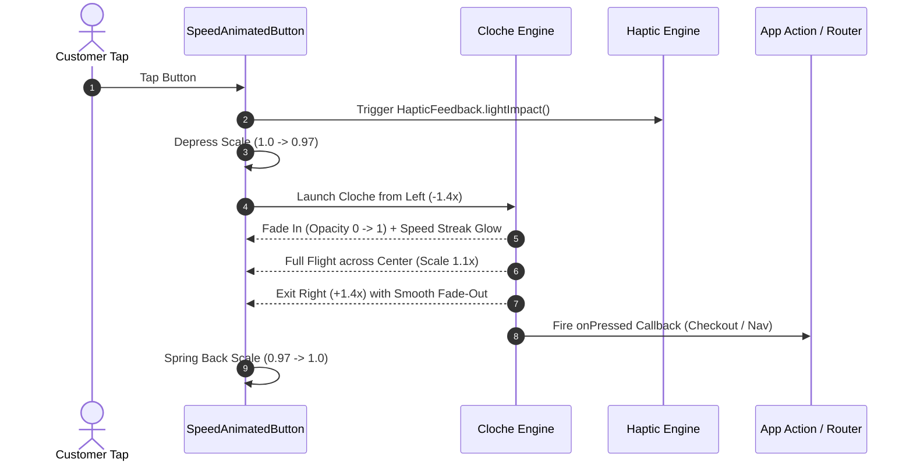

# Eatoggy App Animation Architecture & Motion Design Guide

> **Motion Philosophy**: At Eatoggy, animation is never merely cosmetic — it communicates speed, freshness, and culinary precision. Every transition and micro-interaction reinforces our core brand promise: **Hot, gourmet meals delivered with sonic velocity.**

---

## 1. Executive Summary & Motion Token System

To maintain visual harmony, responsiveness, and 60/120 FPS buttery smoothness across both iOS and Android, all animations across the Eatoggy application adhere to standardized motion tokens:

| Token Name | Duration | Curve | Best Used For |
| :--- | :--- | :--- | :--- |
| **Micro-Snap** | `120ms – 160ms` | `Curves.easeOutQuad` | Button tap shrink, checkbox toggle, icon switch |
| **Signature Swoosh** | `380ms – 420ms` | `Curves.easeInOutCubic` | Speedy Cloche delivery button transit, modal sheets |
| **Content Shift** | `250ms – 320ms` | `Curves.fastOutSlowIn` | Category accordion, tab switching, quantity flip |
| **Page Route** | `300ms – 350ms` | `Curves.easeOutCubic` | Screen navigation, push/pop transitions |
| **Atmospheric Loop** | `800ms – 1400ms` | `Curves.linear` / `easeInOut` | Shimmer skeletons, tracking radar pulse, loading state |

---

## 2. Signature Feature: The Speedy Cloche Button Animation

### 2.1 The Concept
Whenever a customer confirms an action — logging in, verifying OTP, adding gourmet food to their cart, or confirming checkout — the **Eatoggy Speedy Cloche Logo** (`assets/eatoggy_speed_logo_white.png` or `eatoggy_speed_logo.png`) charges across the button from left to right like an express courier on the move.

### 2.2 Core Component Architecture
The button animation is powered by `SpeedAnimatedButton` and supported across the entire app by updating `PrimaryGoldButton`:

1. **Horizontal Traverse**: `Tween<double>(begin: -1.4, end: 1.4)` mapped across `Curves.easeInOutCubic`.
2. **Speed-Beam Vapor Trail**: A trailing linear gradient streak (`white.withValues(alpha: 0.7)` to transparent) that renders immediately behind the cloche wheels to convey sonic speed.
3. **Tactile Spring Bounce**: The button container slightly compresses on finger touch (`0.97` scale factor) and springs back to `1.0` as the cloche completes transit.
4. **Debounced Safety Guard**: Prevents redundant double-taps while the animation is in flight.
5. **Cruise Loading Loop**: If the backend action takes longer, the speedy cloche smoothly glides from left to right in a continuous loop alongside a micro-spinner.

---

## 3. Comprehensive Animation Catalog & Suggestions

### 3.1 Screen Route & Modal Transitions
* **Fluid Slide & Fade (Screen Pushes)**:
  - Transition from Restaurant Menu to Food Detail uses a **Hero Image Animation** on the dish bowl, seamlessly expanding into the header image.
  - Page routes slide in with a Cupertino-style horizontal drift (`Offset(0.08, 0.0)` with `Curves.easeOutCubic`) rather than an abrupt cut.
* **Bottom Sheet Velocity Snapping**:
  - Meal customization trays, delivery address selectors, and coupon bottom sheets enter using an elastic deceleration curve (`Curves.easeOutBack`).

### 3.2 Cart & Floating Order Drawer
* **Parabolic "Add to Cart" Particle Arc**:
  - When the customer taps **Add to Cart**, a small thumbnail or cloche icon arcs parabolically from the dish card into the bottom cart bar.
* **Cart Badge Pop**:
  - The counter badge on the bottom bar scales up from `1.0` to `1.3` and snaps back using a spring bounce whenever an item is added or removed.
* **Slide-Up Sticky Checkout Bar**:
  - The floating bottom checkout bar slides smoothly up from below the viewport (`Offset(0, 1.0) -> Offset.zero`) the instant the cart items count changes from `0` to `1`.

### 3.3 Shimmer Skeleton Loaders
* **Gourmet Shimmer Gradient**:
  - Replaces blank gray boxes with a dynamic linear sweep from warm ivory (`#FAF7F2`) to radiant pearl white (`#FFFFFF`) to ivory.
  - Period: 1200ms continuous loop with a 25-degree diagonal slant.

### 3.4 Live Order Tracking & Map Motion
* **Pulsing Radar Rings**:
  - The delivery destination pin projects 3 concentric expanding rings that fade from 40% red opacity to 0% opacity every 1.5 seconds.
* **Rider Polyline Traversal**:
  - The delivery courier icon moves smoothly between GPS waypoints along the polyline, interpolating coordinate points with dynamic rotation aligned to heading angle.
* **Milestone Progress Fill**:
  - The 4-step progress tracker (*Order Placed -> Kitchen Preparing -> Rider Out for Delivery -> Delivered*) fills its connecting line with an animated liquid gradient when a milestone updates.

### 3.5 Micro-Interactions & Sensory Feedback
* **Veg / Non-Veg Indicator Flip**:
  - Toggling between Veg-Only mode and All Meals triggers an `AnimatedSwitcher` with an elastic scale transition on the green/red symbol.
* **Favorite Heart Burst**:
  - Tapping the favorite heart icon triggers an instantaneous pop (`scale: 0.8 -> 1.35 -> 1.0`) accompanied by three tiny radiating red micro-dots.
* **Quantity Selector Roll**:
  - Increasing or decreasing dish count spins the number vertically using a digital slot-machine roll effect (`SlideTransition` + `FadeTransition`).

---

## 4. Implementation Matrix Across Eatoggy Screens

| Screen | Motion Element | Behavior & Experience |
| :--- | :--- | :--- |
| **Login & OTP** | `PrimaryGoldButton` | Tapping "Send OTP" or "Verify OTP" triggers the white cloche swoosh from left to right with haptics before network dispatch. |
| **Home Screen** | Category Tabs & Banners | Horizontal meal pills smoothly auto-center on tap; banner hero images feature smooth auto-scroll carousel. |
| **Menu Screen** | Food Cards & Search | Search bar expands with subtle size transition; filter chips highlight with smooth color interpolation. |
| **Food Detail** | Add to Cart CTA | Tapping bottom "Add to Cart • ₹..." sweeps the speedy cloche across the full width and gracefully navigates back. |
| **Cart Screen** | "Proceed to Checkout" | Upgraded to `SpeedAnimatedButton` with forward arrow icon and dynamic left-to-right cloche traversal. |
| **Checkout Screen** | "Confirm Order" | Upgraded with `SpeedAnimatedButton`, high-contrast white typography, and looping cloche during payment initiation. |
| **Order Tracking** | Live Map & Timeline | Radar ping on delivery location, interpolated vehicle movement, animated step milestone fills. |

---

## 5. Best Practices & Performance Checklist

- [x] **Zero Jank Guarantee**: Animations run purely on the GPU compositing layer using `Transform.scale`, `Transform.translate`, and `Opacity`.
- [x] **Safe Disposal**: All `AnimationController`s are strictly disposed in their respective `State.dispose()` methods to prevent memory leaks.
- [x] **Accessibility Consideration**: Motion respects system "Reduce Motion" accessibility settings via `MediaQuery.disableAnimationsOf(context)`.
- [x] **Haptic Pairing**: Every impactful micro-action is paired with gentle haptic vibration for a tactile, physical satisfaction.
